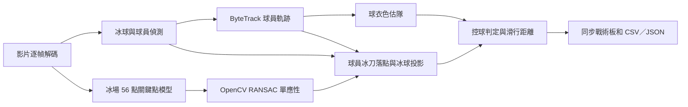

# 冰上曲棍球戰術分析 V1

本機 repo 從 [SnapShot](https://github.com/danielrzhang/SnapShot) 的 `ccfc904c51643b95fce7e3b0c0305df4a331e2ee` 建立，保留上游 [GPL-3.0 授權](LICENSE)。`analyze.py` 沿用 SnapShot 的球員 ByteTrack、HockeyRink 關鍵點順序與冰場底圖，逐幀產生可檢查的戰術板和統計。

| 參考來源 | 本版如何使用 |
| --- | --- |
| [SnapShot](https://github.com/danielrzhang/SnapShot) | 冰球領域基底，提供球員／冰球和冰場關鍵點權重。 |
| [Hockey-Vision](https://github.com/AlexRHaigh/Hockey-Vision) | 參考其冰場投影、球衣號碼與事件匯出設計。 |
| [Roboflow Trackers](https://github.com/roboflow/trackers) 與 [RF-DETR + ByteTrack 示範](https://www.youtube.com/watch?v=u0k2dTZ0vfs) | 後續偵測器對照。兩種偵測器可統一輸出 `supervision.Detections`，交由 ByteTrack 關聯。 |

## 在 PowerShell 執行

使用本機 Windows Conda `cv` 的 Python 3.9。下列 PowerShell 指令直接指定該直譯器，可以從 VS Code 終端機執行。這台電腦的 RTX 4060 可用 PyTorch 2.7.1+cu118 與 torchvision 0.22.1+cu118。若搬到另一台電腦，請改成該機的 `cv` Python 路徑。 [PyTorch 安裝指引](https://pytorch.org/get-started/locally/)

```powershell
# 請先進入 ice-hockey-tactics repo 根目錄。
$cvPy = Join-Path $env:USERPROFILE 'anaconda3\envs\cv\python.exe'
& $cvPy -c "import sys, torch, cv2; print(sys.executable, torch.__version__, torch.cuda.is_available(), cv2.__version__)"
```

若剛重建 `cv`，先安裝 CUDA 版 PyTorch 與 torchvision，再執行以下依賴安裝。此工作區的套件已裝好。

```powershell
& $cvPy -m pip install -r requirements-tactics.txt
```

新 checkout 需要將上游權重放入 `models`。以下下載固定版本，只補上本機缺少的檔案。 [SnapShot 權重來源](https://github.com/danielrzhang/SnapShot/tree/ccfc904c51643b95fce7e3b0c0305df4a331e2ee/models)

```powershell
$weightsBase = 'https://raw.githubusercontent.com/danielrzhang/SnapShot/ccfc904c51643b95fce7e3b0c0305df4a331e2ee/models'
New-Item -ItemType Directory -Force -Path 'models' | Out-Null
foreach ($name in @('player-detector.pt', 'puck-detector.pt', 'rink-detector.pt')) {
    $path = Join-Path 'models' $name
    if (-not (Test-Path -LiteralPath $path)) {
        Invoke-WebRequest -Uri "$weightsBase/$name" -OutFile "$path.part" -ErrorAction Stop
        Move-Item -LiteralPath "$path.part" -Destination $path -ErrorAction Stop
    }
}
```

在 repo 根目錄貼上以下指令。`--output` 每次指定新資料夾，`--team-a` 和 `--team-b` 輸入兩隊主球衣的 CSS 色名。樣片為 WMrapids 的 [Simon Edvinsson empty net goal](https://commons.wikimedia.org/wiki/File:Simon_Edvinsson_empty_net_goal.webm)，授權為 CC0。本機樣片路徑為 `input-videos/edvinsson.webm`。

```powershell
$env:YOLO_CONFIG_DIR = Join-Path $PWD 'all-runs\ultralytics-config'
New-Item -ItemType Directory -Path $env:YOLO_CONFIG_DIR -Force | Out-Null
& $cvPy analyze.py input-videos/edvinsson.webm --team-a navy --team-b white --device 0 --half --max-frames 120 --output output-videos/first-run
```

要跑本機訓練好的 YOLO11n，可使用同一段上游 NHL 示範片比較。將原始樣片存為 `input-videos/snapshot-demo.mp4`。 [SnapShot 原始示例](https://github.com/danielrzhang/SnapShot#before-snapshot-processing)

```powershell
$weights = 'all-runs/hockeyai-yolo11n-clean/weights/best.pt'
& $cvPy analyze.py input-videos/snapshot-demo.mp4 --team-a green --team-b white --weights $weights --device 0 --half --max-frames 360 --output output-videos/first-yolo11
```

想先看有控球歸隊的畫面，可用上游偵測器和 640 冰場輸入跑同一段。第 180 幀起可在 `frames.csv` 找到 A 隊的控球記錄。

```powershell
& $cvPy analyze.py input-videos/snapshot-demo.mp4 --team-a green --team-b white --device 0 --half --max-frames 360 --rink-imgsz 640 --output output-videos/first-possession
```

移除 `--device 0 --half` 可用 CPU。移除 `--max-frames 120` 可跑完整影片。加入 `--preview` 可邊處理邊看，按 Q 結束並寫出摘要。`--rink-imgsz` 可個別調整冰場模型的輸入大小。每次輸入同一個連續鏡頭，優先選能看到藍線、開球點和冰面的廣角片段。

| 參數 | 用法與預設值 |
| --- | --- |
| `source`、`--output` | 來源影片及新的輸出目錄。兩者均須指定。 |
| `--team-a`、`--team-b` | 兩隊主球衣的 CSS 色名。請選兩種不同顏色。 |
| `--weights`、`--rink-weights` | 可分別指定冰球偵測器與冰場模型。省略時使用 `models/player-detector.pt` 和 `models/rink-detector.pt`。替換冰場模型需保留原本的 56 點順序。 |
| `--device`、`--half` | 預設 `cpu`。`--device 0 --half` 使用第 0 張 CUDA GPU 與 FP16。 |
| `--imgsz`、`--rink-imgsz` | 偵測器的預設輸入大小為 960。冰場模型預設沿用相同值。 |
| `--puck-conf` | 預設 0.25，範圍 0.1 到 1。調低會保留更多候選，也需要檢查誤報。 |
| `--start-frame`、`--max-frames` | 預設從第 0 幀開始，讀到影片結尾。可輸入起始幀與最多處理幀數。 |
| `--preview` | 開啟 OpenCV 視窗並顯示當下結果。按 Q 或 Esc 結束並保留已完成的幀。 |

| 輸出 | 驗收方式 |
| --- | --- |
| `tactics.mp4` | 左側是偵測框和 ByteTrack ID，右側是同一幀的俯視戰術板和累計控球率。暫停比對冰刀落點、球門方向、隊色和冰球位置。分析影片不含原音。 |
| `frames.csv` | 每幀記錄校正內點數、冰球信心與座標、控球 ID 和累計百分比。`possession_team` 的 0、1、2 分別表示未知、A、B。 |
| `tracks.csv` | 每筆為同一幀中的一條軌跡，含畫面框、冰場公尺座標與累計觀測距離。沒有可靠投影時，公尺座標留空。 |
| `summary.json` | 檢查校正成功率、冰球投影覆蓋、控球未知比例、每個 ID 的有效距離段數與處理 FPS。 |

## 第一版功能與資料流



| 功能 | 畫面或資料如何產生 | 程式位置 |
| --- | --- | --- |
| 影片讀取 | OpenCV 一次讀一幀。每幀共用一個球員／冰球偵測結果，另執行冰場模型。處理限制只影響輸出片長。 | [`analyze.py`](analyze.py) |
| 球員偵測與分類 | 選取球員、滑冰員與守門員標籤。裁判和場地物件類別不送入球員追蹤。原始框的座標單位為像素。 | [`analyze.py`](analyze.py) |
| 球員遮擋追蹤 | ByteTrack 用框位置和連續幀的動作關聯 ID。高信心偵測啟動軌跡，較低信心偵測有機會維持既有軌跡。漏檢幀不填入可見位置，短暫重現可能續用原 ID。 | [`trackers/player_tracker.py`](trackers/player_tracker.py) |
| 冰球定位 | 每幀選擇通過 `--puck-conf` 的最高信心冰球框，畫面用黃圈標記。冰球以逐幀觀測記錄，沒有額外追蹤 ID。 | [`analyze.py`](analyze.py) |
| 球衣辨識 | 取人物框上半部中央的球衣區域，對 Lab 色彩取中位數，計算與兩隊指定顏色的距離差。對同一 ID 跨幀平滑，分數接近時保持未知並畫灰色。 | [`tactics.py`](tactics.py) |
| 冰場校正 | HockeyRink Pose 輸出各關鍵點的位置與信心。以可信的畫面點對應 NHL 模板上的已知公尺座標，再透過 OpenCV RANSAC 擬合像素到公尺的 3×3 單應性矩陣。校正按當幀獨立估計。 | [`tactical_view_converter`](tactical_view_converter) |
| 俯視戰術板 | 以球員框底邊中心近似冰刀落點，以冰球框中心近似冰面位置。將兩者映射到冰場平面。戰術板上顯示隊色、軌跡 ID、冰球黑點及持球者外圈。 | [`tactics.py`](tactics.py)、[`drawers/tactical_view_drawer.py`](drawers/tactical_view_drawer.py) |
| 即時統計 | 邊讀影片邊更新累計控球和滑行距離，寫入當幀畫面與表格。加入 `--preview` 可看處理進度，實際播放速度取決於推論吞吐。 | [`tactics.py`](tactics.py)、[`analyze.py`](analyze.py) |

## 統計口徑

- 球員框底邊中心近似冰刀落點。OpenCV 以 RANSAC 配對 56 點 NHL 冰場模板中的可見關鍵點。保留關鍵點信心至少 0.45 的可見點，RANSAC 的距離門檻為 1 公尺，至少 6 個內點才採用當幀校正。冰場尺寸沿用上游 200 × 85 英尺，換算為 60.96 × 25.908 公尺。冰球以框中心投影，飛離冰面時位置可能偏移。
- 球員與冰球共用一次偵測。球員交由 ByteTrack 關聯，球衣色用 Lab 色差與跨幀平滑估隊。ByteTrack ID 對應本段影片中的軌跡，遇到長時間完全遮擋或出畫後可能換 ID。
- 控球候選是距離冰球 2 公尺內且至少比次近球員近 0.5 公尺的球員。隊別已知且證據持續約 0.12 秒才歸隊。冰球漏檢、校正失敗、多人接近或隊色不確定的畫面計入 `unknown`。兩隊與未知的百分比均以已處理的全部幀為分母，時間以來源固定 FPS 近似。
- 滑行距離只累加同 ID 在相鄰有效幀的冰面位移。超過 15 m/s 的跳點與缺測區間略過。結果會受框位置抖動、投影誤差、遮擋與 ID 切換影響，應解讀為可觀測軌跡的距離估計。

### 數字怎麼讀

- `frames.csv` 的 `frame` 從 0 開始。`time_s = frame / source_fps`，所以從第 120 幀開始也會保留來源時間。`calibration_inliers=0` 表示沒有可用校正。冰球出現在影片但漏檢時，信心和座標留空。偵測到了但不能投影時，只會填信心。
- `tracks.csv` 的 `x1_px` 到 `y2_px` 是來源畫面的偵測框，`x_m` 沿冰場長邊、`y_m` 沿短邊，原點在模板左上方。`observed_distance_m` 從第一次取得有效相鄰位移開始累積。`summary.json` 的 `null` 表示該 ID 尚未有有效位移段。
- `unknown_pct` 包含無法判定的所有幀，其中可能有漏檢、未校正、多人爭球或隊別未穩定。以 100 幀為例，若 A 隊 25 幀、B 隊 35 幀，其餘 40 幀未知，畫面顯示 25%、35%、40%。
- `processing_fps` 計入影片解碼、兩個模型、畫面繪製與寫檔。輸出影片用來源 FPS 編碼。例如來源 30 FPS 而處理 17 FPS 時，輸出的影片仍可正常速度播放，現場預覽的更新約每秒 17 幀。

## 用自己的影片操作與檢查

1. 先挑 5–15 秒的連續廣角鏡頭，確認至少能看到部分藍線、開球點或球門線。轉播畫面切到重播、球員特寫或另一台攝影機時，從切點分成不同檔案。將影片放入 `input-videos`。
2. 依球衣主色修改隊色，先跑 120 幀。`--start-frame 150` 可從指定幀開始，每個分析段各自建立新軌跡。`--output` 每次使用新目錄。
3. 先核對 `tactics.mp4` 中的冰場方向和冰刀落點。再對照 `frames.csv` 裡校正成功的幀與冰球黃圈。有持球外圈時，回看前後幀確認球桿與冰球是否接近。
4. 對照球員短暫遮擋前後的 ID，以及 `tracks.csv` 的距離是否只在連續有效觀測增加。`summary.json` 中每個 ID 的 `valid_distance_segments` 可用來區分有長段觀測和只出現零星幀的情況。

| 現象 | 可以怎麼檢查 |
| --- | --- |
| 戰術板空白 | 檢查 `calibration_inliers`。優先換較廣角片段。若先前有縮小 `--rink-imgsz`，先恢復到與 `--imgsz` 相同再比對。 |
| 影片有冰球，`puck_confidence` 多數為空 | 放大來源畫面核對模糊、遮擋與標記大小。可用較大的 `--imgsz` 或另跑一次 `--puck-conf 0.15` 比較黃圈誤報。每次只調一項並保留兩份輸出。 |
| 控球長期未知 | 先分開看 `puck_frames`、`calibrated_frames`、`projected_puck_frames`。若三者覆蓋不足，先檢查畫面與校正。若三者都有，查看隊色是否判對，以及冰球與球員是否維持接近。 |
| 距離突增或有多個 ID | 對照影片中的遮擋、出畫、鏡頭方向與框跳動。每個 ID 是一段觀測軌跡，人工確認同一人後才能合併。 |
| CUDA 找不到 | 用指定的 `$cvPy` 檢查 `torch.cuda.is_available()`。若先驗證流程，可以省略 `--device 0 --half` 用 CPU。 |

## YOLO11n 重建

官方 HockeyAI 資料集的標註採 YOLO 格式。準備腳本讀取 ZIP 中的 2,101 對影像和標註，排除 30 組具重複內容且標註檔不同的影像，共排除 60 張，再用種子 42 切分為訓練 1,633 張、驗證 204 張、測試 204 張。以原始 UUID 為影像 ID。ZIP 未提供可驗證的比賽分組欄位，因此這是影像級切分。近似相鄰畫面仍有可能分到不同集合。 [HockeyAI 資料集](https://huggingface.co/datasets/SimulaMet-HOST/HockeyAI)

```powershell
& $cvPy prepare_hockeyai.py dataset/HockeyAI_Dataset.zip dataset/hockeyai-clean
$dataPath = Join-Path $PWD 'dataset\hockeyai-clean\data.yaml'
Push-Location all-runs
try {
    & $cvPy -c "from ultralytics import YOLO; YOLO('yolo11n.pt').train(data=r'$dataPath', epochs=8, imgsz=960, batch=4, workers=0, device=0, seed=42, cache=False, plots=False, project='.', name='hockeyai-yolo11n-clean')"
} finally { Pop-Location }
```

`dataset/HockeyAI_Dataset.zip` 和 `all-runs/yolo11n.pt` 已在本機。若需重取，從 [HockeyAI 檔案頁](https://huggingface.co/datasets/SimulaMet-HOST/HockeyAI/blob/2f7b631/HockeyAI_Dataset.zip) 和 [Ultralytics 官方權重](https://github.com/ultralytics/assets/releases/download/v8.3.0/yolo11n.pt) 下載。`--weights` 傳入自己的 YOLO11 Detect `.pt` 即可換掉基準偵測器，冰場模型仍沿用原本的 56 點模型。通用 COCO 權重沒有冰球類別。

資料夾已存在時，重跑準備腳本請改用新資料夾並更新 `$dataPath`。要重現已完成的 checkpoint 評估，可對去重後的 `test` 分割執行以下指令。

```powershell
& $cvPy -c "from ultralytics import YOLO; YOLO('all-runs/hockeyai-yolo11n-clean/weights/best.pt').val(data='dataset/hockeyai-clean/data.yaml', split='test', imgsz=960, batch=4, device=0, workers=0, plots=False, project='all-runs', name='hockeyai-test')"
```

## 驗證紀錄

```powershell
& $cvPy -m unittest -v test_tactics
```

四項回歸測試通過，涵蓋退化校正、RANSAC 離群點、軌跡中斷及跳點、控球中斷及多人接近。另以固定偵測框檢查 ByteTrack，確認低信心偵測沿用同一 ID，且在三幀無偵測後可恢復該 ID。

### YOLO11n 偵測測試

以官方 YOLO11n 初始化，訓練 8 個 epoch，輸入大小 960，batch 4。前 3 個 epoch 在準備環境完成，第 4 到第 8 個 epoch 由 Windows `cv` 接續同一 checkpoint。Ultralytics 略過訓練集中 5 張、驗證集中 1 張含超界標註的影像，完整讀取測試集 204 張。正式 checkpoint 為 `all-runs/hockeyai-yolo11n-clean/weights/best.pt`。完整各類結果在 `all-runs/hockeyai-yolo11n-clean/test-metrics.json`。

| 測試項目 | Precision | Recall | AP50 | AP50–95 |
| --- | ---: | ---: | ---: | ---: |
| 七類平均 | 83.0% | 84.6% | 85.9% | 62.6% |
| 球員 | 67.4% | 96.2% | 91.7% | 58.4% |
| 守門員 | 88.7% | 93.2% | 93.3% | 55.0% |
| 冰球 | 48.7% | 23.0% | 30.5% | 8.4% |

AP50 以預測框和標註框的 IoU ≥ 0.50 判定配對，再從精確率與召回率曲線計算。AP50–95 平均了 0.50 至 0.95 的 IoU 門檻。冰球召回率是此測試中最明顯的限制。表內數字評估的是單幀偵測，影片的控球、軌跡與校正需分別驗證。

### 實拍影片輸出

RTX 4060 以 FP16 推論，下表的處理 FPS 含解碼、模型推論、繪圖和檔案寫入。輸出 MP4 幀數、CSV 列數與 `summary.json` 中的校正和控球計數均已交叉核對。

| 片段 | 分析幀數 | 校正成功 | 冰球投影 | 有有效距離段的 ID | 來源／處理 FPS |
| --- | ---: | ---: | ---: | ---: | ---: |
| Edvinsson，`imgsz=960` | 541 | 114 | 24 | 18 | 59.94／16.7 |
| Ferris State，`imgsz=640` | 211 | 0 | 0 | 0 | 15.0／33.6 |
| SnapShot 原始示例前 12 秒，`imgsz=960` | 360 | 226 | 69 | 9 | 30.0／16.9 |
| 同一 NHL 片段，上游 YOLOv8、冰場 640，Windows `cv` | 360 | 332 | 104 | 10 | 30.0／19.5 |
| 同一 NHL 片段，YOLO11n 960、冰場 960，Windows `cv` | 360 | 226 | 26 | 29 | 30.0／16.5 |
| 同一 NHL 片段，YOLO11n 960、冰場 640，Windows `cv` | 360 | 332 | 31 | 37 | 30.0／18.3 |

Edvinsson 和 Ferris State 的控球皆為 100% 未知。Edvinsson 有冰球投影，但可用證據未達歸隊條件。Ferris State 解析度低且有防護網，未取得冰場校正。SnapShot 基準有 1 幀歸給 A 隊，抽查畫面可見冰球標記位於綠衣球員的桿頭附近。冰場輸入降為 640 時，上游 YOLOv8 有 10 幀歸給 A 隊、350 幀未知。YOLO11n 在同一段的兩次控球輸出皆為未知。冰場大小調為 640 後，有效校正幀從 226 增到 332。這是單一片段的結果，還需檢查冰場點位誤差才能判斷投影是否更準。29 或 37 條有距離的 ID 也可能包含遮擋後分裂的軌跡或重複框。

基準輸出在 `output-videos/edvinsson-full`、`output-videos/ferris-full`、`output-videos/snapshot-demo` 和 `output-videos/snapshot-cv-rink640`。YOLO11n 的輸出在 `output-videos/yolo11-nhl-960` 和 `output-videos/yolo11-nhl-rink640`。

Ferris State 片段由 Michael Barera 拍攝，本機輸出為加上分析標註的版本。 [原始影片](https://commons.wikimedia.org/wiki/File:Ferris_State_on_a_power_play.ogv) · [CC BY-SA 4.0](https://creativecommons.org/licenses/by-sa/4.0/)

目前的影片檢查屬於流程驗證。若要評估可用性，請用人工標註的獨立比賽片段分別核對冰球偵測召回率、遮擋後 ID 延續率、冰場投影誤差、控球逐幀一致率與軌跡距離誤差。
